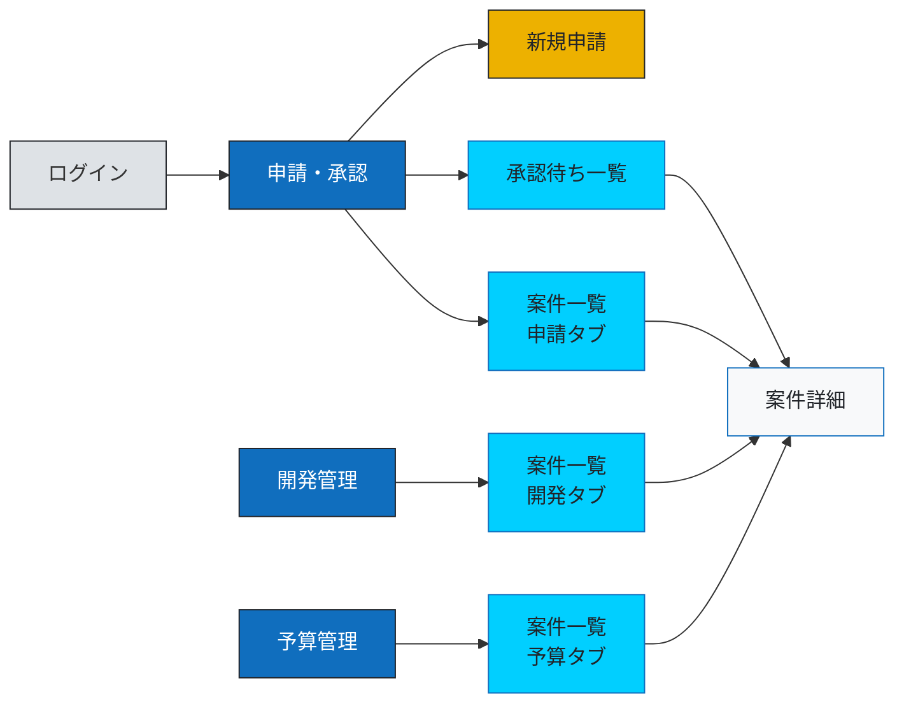
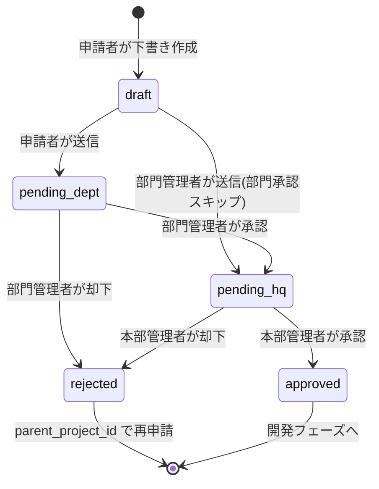
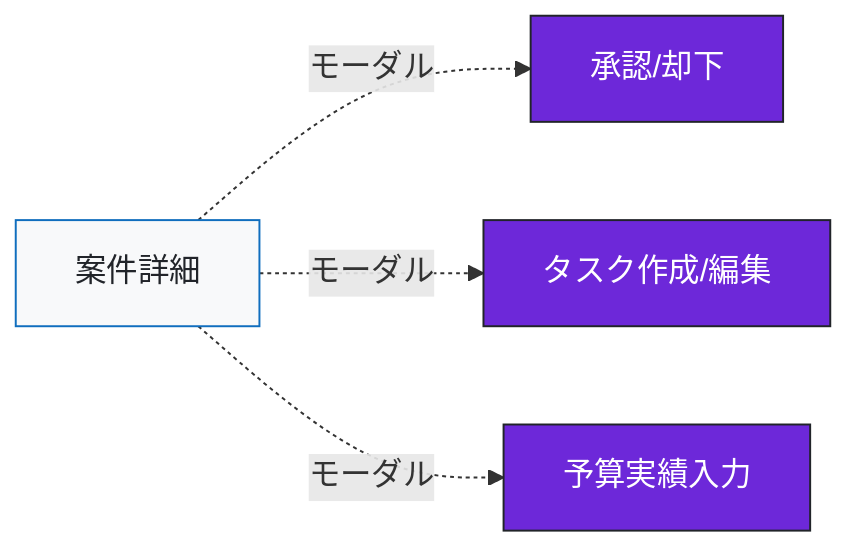

# 画面遷移設計 - 開発管理統合アプリケーション PoC

> 本ドキュメントは Claude でのモック作成と Cursor での実装指示の両方に利用することを想定。
> 画面ごとに「目的 / アクセス可能ロール / データソース / 主要UI要素 / 遷移先」を定義する。

> **スコープ方針（2026-04-16 改訂）**
> - **課題1（必須）**: 申請・承認、開発管理（タスクは最小限）、予算管理の3本柱を100hで実装
> - **課題2（+α・企画力の提示）**: ダッシュボード、予算リアルタイム可視化、承認ステップ表示などは「テーブル設計」と「プレゼン」で示す。実装は開発期間後のポートフォリオ拡張フェーズに回す
> - ログイン直後のホームはダッシュボードが理想だが、PoCでは **案件一覧（申請・承認タブ）** を暫定ホームとする

---

## 1. ナビゲーション構成（3セクション）

トップナビは **申請・承認 / 開発管理 / 予算管理** の3本。各セクションをクリックすると、そのフェーズで必要な画面群にアクセスできる。

| セクション | 含まれる画面 | 主なロール |
|-----------|-------------|----------|
| **申請・承認** | 新規申請 / 承認待ち一覧 / 案件一覧（申請タブ） | 申請者・部門管理者・本部管理者 |
| **開発管理** | 案件一覧（開発タブ） / 案件詳細 / タスク一覧（課題2） / タスク入力 | 申請者（主担当）・管理者 |
| **予算管理** | 案件一覧（予算タブ） / 予算実績入力 | 申請者（主担当）・管理者（閲覧） |

**案件一覧はセクション共通の画面**で、セクションごとに表示する列（タブ）を切り替える。詳細は §4。

---

## 2. 画面一覧

| ID | 画面名 | URL案 | 所属セクション | 目的 |
|----|-------|-------|---------------|------|
| S-01 | ログイン | `/login` | - | 認証 |
| S-03 | 案件一覧 | `/projects?tab={approval\|dev\|budget}` | 3セクション共通 | フェーズ別に列を切り替えて案件を一覧 |
| S-04 | 案件詳細 | `/projects/{id}` | 開発管理（主） | 案件の全情報・承認履歴・タスク・予算 |
| S-05 | 新規申請 | `/projects/create` | 申請・承認 | 案件の新規申請フォーム |
| S-06 | 案件編集 | `/projects/{id}/edit` | 申請・承認 | draft時のみの編集 |
| S-07 | 承認待ち一覧 | `/approvals` | 申請・承認 | 自分が承認すべき案件 |
| S-08 | 承認処理モーダル | S-04内 | 申請・承認 | 承認/却下＋コメント |
| S-10 | タスク入力（作成/編集） | S-04内モーダル | 開発管理 | タスクCRUD（最小限） |
| S-11 | 予算実績入力 | S-04内モーダル | 予算管理 | actual_amount の入力 |
| S-12 | 通知一覧 | `/notifications` | グローバル | アプリ内通知 |
| S-13 | プロフィール | `/profile` | グローバル | Breeze標準 |

### 課題2（+α）として設計のみ行う画面
| ID | 画面名 | 状態 |
|----|-------|------|
| S-02 | ダッシュボード | テーブル設計・モックのみ。実装は後回し |
| S-09 | タスク詳細 | タスク一覧が課題2扱いのため、詳細も一緒に後回し |

**PoCでは実装しない**: ユーザー管理、部門管理、ロール付与（seederで投入）。

---

## 3. ロール別アクセス可視範囲

| 画面 | 申請者 (applicant) | 部門管理者 (dept_manager) | 本部管理者 (hq_manager) |
|------|:---:|:---:|:---:|
| S-03 案件一覧 | `applicant_id = self` + draft | `department_id = self.dept` | 全件 |
| S-04 案件詳細 | 自案件のみ | 自部門の案件 | 全件 |
| S-05 新規申請 | ○ | ○（部門承認スキップ） | × |
| S-07 承認待ち | × | `level=dept` の案件 | `level=hq` の案件 |
| S-10 タスクCRUD | 自案件（主担当） | 自部門（閲覧中心） | 全件（閲覧中心） |
| S-11 予算実績入力 | 自案件の主担当 | × | × |

Controller のクエリ分岐 + Spatie Permission + Policy で実装。

---

## 4. 案件一覧（S-03）のタブ切り替え仕様

ナビゲーションから入ったセクションに応じて、デフォルトで選択されるタブと表示列が変わる。タブクリックで他フェーズの列セットにも切り替え可能。

### 4-1. 申請タブ（申請・承認セクションから流入）
**目的**: 自分が申請中のもの・ドラフト・却下されたものを追う

| 列 | 内容 |
|----|------|
| タイトル | リンク |
| ステータスバッジ | draft / pending_dept / pending_hq / approved / rejected |
| 申請日 | created_at |
| 承認ステップ | ステッパー簡易表示（課題2の要素をここに差し込む） |
| 部門 | department.name |
| 最終更新 | updated_at |

**フィルタ既定**: `status IN (draft, pending_*, rejected)`（approved は別タブで）

### 4-2. 開発タブ（開発管理セクションから流入）
**目的**: 承認済み案件の進捗を把握

| 列 | 内容 |
|----|------|
| タイトル | リンク |
| 部門 | department.name |
| 主担当 | users.name |
| タスク進捗 | 完了タスク数 / 全タスク数（課題2の一部） |
| 期限 | end_date or 最遅タスクdue |
| 最終更新 | updated_at |

**フィルタ既定**: `status = approved`

### 4-3. 予算タブ（予算管理セクションから流入）
**目的**: 予算消費状況の俯瞰

| 列 | 内容 |
|----|------|
| タイトル | リンク |
| 部門 | department.name |
| 予算額 | budget_amount |
| 実績額 | actual_amount |
| 消費率 | バー表示（70%超で黄色、90%超で赤） |
| 更新日 | updated_at |

**フィルタ既定**: `status = approved`

**共通フィルタ**: キーワード検索、部門、期間。共通のソート（更新日降順）。

---

## 5. 画面遷移図（Mermaid）

### 5-1. 全体ナビゲーション

### 5-2. 承認ステータス遷移

### 5-3. 案件詳細内のモーダル

---

## 6. ロール別・典型フロー

### 6-1. 申請者（applicant）
1. ログイン（S-01）→ **申請・承認 → 案件一覧（申請タブ）** で自案件ステータス確認
2. 「新規申請」（S-05）で案件を起票 → `status=pending_dept`
3. 承認後、**開発管理 → 案件一覧（開発タブ）→ 案件詳細（S-04）** でタスク作成（S-10）
4. 月末などに **予算管理 → 予算実績入力（S-11）** で actual_amount を入力
5. 通知（S-12）で承認完了・却下を受信

### 6-2. 部門管理者（dept_manager）
1. **申請・承認 → 承認待ち一覧（S-07）** で level=dept を承認/却下
2. 自部門の案件を **開発管理・予算管理** の各タブで横断把握
3. 自身が申請者になる場合は S-05 から申請（部門承認スキップ）

### 6-3. 本部管理者（hq_manager）
1. **申請・承認 → 承認待ち一覧（S-07）** で最終承認
2. **予算管理タブ** で全部門の予算消費率を一覧（課題2：リアルタイム可視化の導線）
3. 全件閲覧

---

## 7. 画面ごとの主要UI要素

### S-03 案件一覧（共通コンポーネント）
- タブ切替UI: 申請 / 開発 / 予算（URLクエリ `?tab=` で状態保持）
- 検索・フィルタ（キーワード / 部門 / 期間 / ステータス）
- 「新規申請」ボタンは **申請タブ時のみ** 表示（申請者・部門管理者）
- 列はタブごとに §4 に従って切替

### S-04 案件詳細
- ヘッダー: タイトル・ステータスバッジ・部門・申請者・主担当
- **承認ステッパー**: 申請 → 部門承認 → 本部承認 → 承認済（課題2要素だが設計として入れる）
- セクション:
  - 概要（purpose / estimated_amount / budget_amount / actual_amount / 消費率バー）
  - タスク一覧（課題2：テーブル表示のみ、承認後に表示）
  - 承認履歴（approvals）
  - 変更履歴
- 右サイド: 承認/却下ボタン（権限者）・編集（draft時の申請者）・予算実績入力（主担当）

### S-05 新規申請
- フォーム: タイトル / 目的 / 部門 / 概算予算 / 説明
- 送信 → `pending_dept`（申請者）/ `pending_hq`（部門管理者）

## 画面遷移設計 - 開発管理統合アプリケーション PoC

> 本ドキュメントは Claude でのモック作成と Cursor での実装指示の両方に利用することを想定。
> 画面ごとに「目的 / アクセス可能ロール / データソース / 主要UI要素 / 遷移先」を定義する。

> **スコープ方針（2026-04-16 改訂）**
> - **課題1（必須）**: 申請・承認、開発管理（タスクは最小限）、予算管理の3本柱を100hで実装
> - **課題2（+α・企画力の提示）**: ダッシュボード、予算リアルタイム可視化、承認ステップ表示などは「テーブル設計」と「プレゼン」で示す。実装は開発期間後のポートフォリオ拡張フェーズに回す
> - ログイン直後のホームはダッシュボードが理想だが、PoCでは **案件一覧（申請・承認タブ）** を暫定ホームとする

---

## 1. ナビゲーション構成（3セクション）

トップナビは **申請・承認 / 開発管理 / 予算管理** の3本。各セクションをクリックすると、そのフェーズで必要な画面群にアクセスできる。

| セクション | 含まれる画面 | 主なロール |
|-----------|-------------|----------|
| **申請・承認** | 新規申請 / 承認待ち一覧 / 案件一覧（申請タブ） | 申請者・部門管理者・本部管理者 |
| **開発管理** | 案件一覧（開発タブ） / 案件詳細 / タスク一覧（課題2） / タスク入力 | 申請者（主担当）・管理者 |
| **予算管理** | 案件一覧（予算タブ） / 予算実績入力 | 申請者（主担当）・管理者（閲覧） |

**案件一覧はセクション共通の画面**で、セクションごとに表示する列（タブ）を切り替える。詳細は §4。

---

## 2. 画面一覧

| ID | 画面名 | URL案 | 所属セクション | 目的 |
|----|-------|-------|---------------|------|
| S-01 | ログイン | `/login` | - | 認証 |
| S-03 | 案件一覧 | `/projects?tab={approval\|dev\|budget}` | 3セクション共通 | フェーズ別に列を切り替えて案件を一覧 |
| S-04 | 案件詳細 | `/projects/{id}` | 開発管理（主） | 案件の全情報・承認履歴・タスク・予算 |
| S-05 | 新規申請 | `/projects/create` | 申請・承認 | 案件の新規申請フォーム |
| S-06 | 案件編集 | `/projects/{id}/edit` | 申請・承認 | draft時のみの編集 |
| S-07 | 承認待ち一覧 | `/approvals` | 申請・承認 | 自分が承認すべき案件 |
| S-08 | 承認処理モーダル | S-04内 | 申請・承認 | 承認/却下＋コメント |
| S-10 | タスク入力（作成/編集） | S-04内モーダル | 開発管理 | タスクCRUD（最小限） |
| S-11 | 予算実績入力 | S-04内モーダル | 予算管理 | actual_amount の入力 |
| S-12 | 通知一覧 | `/notifications` | グローバル | アプリ内通知 |
| S-13 | プロフィール | `/profile` | グローバル | Breeze標準 |

### 課題2（+α）として設計のみ行う画面
| ID | 画面名 | 状態 |
|----|-------|------|
| S-02 | ダッシュボード | テーブル設計・モックのみ。実装は後回し |
| S-09 | タスク詳細 | タスク一覧が課題2扱いのため、詳細も一緒に後回し |

**PoCでは実装しない**: ユーザー管理、部門管理、ロール付与（seederで投入）。

---

## 3. ロール別アクセス可視範囲

| 画面 | 申請者 (applicant) | 部門管理者 (dept_manager) | 本部管理者 (hq_manager) |
|------|:---:|:---:|:---:|
| S-03 案件一覧 | `applicant_id = self` + draft | `department_id = self.dept` | 全件 |
| S-04 案件詳細 | 自案件のみ | 自部門の案件 | 全件 |
| S-05 新規申請 | ○ | ○（部門承認スキップ） | × |
| S-07 承認待ち | × | `level=dept` の案件 | `level=hq` の案件 |
| S-10 タスクCRUD | 自案件（主担当） | 自部門（閲覧中心） | 全件（閲覧中心） |
| S-11 予算実績入力 | 自案件の主担当 | × | × |

Controller のクエリ分岐 + Spatie Permission + Policy で実装。

---

## 4. 案件一覧（S-03）のタブ切り替え仕様

ナビゲーションから入ったセクションに応じて、デフォルトで選択されるタブと表示列が変わる。タブクリックで他フェーズの列セットにも切り替え可能。

### 4-1. 申請タブ（申請・承認セクションから流入）
**目的**: 自分が申請中のもの・ドラフト・却下されたものを追う

| 列 | 内容 |
|----|------|
| タイトル | リンク |
| ステータスバッジ | draft / pending_dept / pending_hq / approved / rejected |
| 申請日 | created_at |
| 承認ステップ | ステッパー簡易表示（課題2の要素をここに差し込む） |
| 部門 | department.name |
| 最終更新 | updated_at |

**フィルタ既定**: `status IN (draft, pending_*, rejected)`（approved は別タブで）

### 4-2. 開発タブ（開発管理セクションから流入）
**目的**: 承認済み案件の進捗を把握

| 列 | 内容 |
|----|------|
| タイトル | リンク |
| 部門 | department.name |
| 主担当 | users.name |
| タスク進捗 | 完了タスク数 / 全タスク数（課題2の一部） |
| 期限 | end_date or 最遅タスクdue |
| 最終更新 | updated_at |

**フィルタ既定**: `status = approved`

### 4-3. 予算タブ（予算管理セクションから流入）
**目的**: 予算消費状況の俯瞰

| 列 | 内容 |
|----|------|
| タイトル | リンク |
| 部門 | department.name |
| 予算額 | budget_amount |
| 実績額 | actual_amount |
| 消費率 | バー表示（70%超で黄色、90%超で赤） |
| 更新日 | updated_at |

**フィルタ既定**: `status = approved`

**共通フィルタ**: キーワード検索、部門、期間。共通のソート（更新日降順）。

---

## 5. 画面遷移図（Mermaid）

### 5-1. 全体ナビゲーション

### 5-2. 承認ステータス遷移

### 5-3. 案件詳細内のモーダル

---

## 6. ロール別・典型フロー

### 6-1. 申請者（applicant）
1. ログイン（S-01）→ **申請・承認 → 案件一覧（申請タブ）** で自案件ステータス確認
2. 「新規申請」（S-05）で案件を起票 → `status=pending_dept`
3. 承認後、**開発管理 → 案件一覧（開発タブ）→ 案件詳細（S-04）** でタスク作成（S-10）
4. 月末などに **予算管理 → 予算実績入力（S-11）** で actual_amount を入力
5. 通知（S-12）で承認完了・却下を受信

### 6-2. 部門管理者（dept_manager）
1. **申請・承認 → 承認待ち一覧（S-07）** で level=dept を承認/却下
2. 自部門の案件を **開発管理・予算管理** の各タブで横断把握
3. 自身が申請者になる場合は S-05 から申請（部門承認スキップ）

### 6-3. 本部管理者（hq_manager）
1. **申請・承認 → 承認待ち一覧（S-07）** で最終承認
2. **予算管理タブ** で全部門の予算消費率を一覧（課題2：リアルタイム可視化の導線）
3. 全件閲覧

---

## 7. 画面ごとの主要UI要素

### S-03 案件一覧（共通コンポーネント）
- タブ切替UI: 申請 / 開発 / 予算（URLクエリ `?tab=` で状態保持）
- 検索・フィルタ（キーワード / 部門 / 期間 / ステータス）
- 「新規申請」ボタンは **申請タブ時のみ** 表示（申請者・部門管理者）
- 列はタブごとに §4 に従って切替

### S-04 案件詳細
- ヘッダー: タイトル・ステータスバッジ・部門・申請者・主担当
- **承認ステッパー**: 申請 → 部門承認 → 本部承認 → 承認済（課題2要素だが設計として入れる）
- セクション:
  - 概要（purpose / estimated_amount / budget_amount / actual_amount / 消費率バー）
  - タスク一覧（課題2：テーブル表示のみ、承認後に表示）
  - 承認履歴（approvals）
  - 変更履歴
- 右サイド: 承認/却下ボタン（権限者）・編集（draft時の申請者）・予算実績入力（主担当）

### S-05 新規申請
- フォーム: タイトル / 目的 / 部門 / 概算予算 / 説明
- 送信 → `pending_dept`（申請者）/ `pending_hq`（部門管理者）

### S-07 承認待ち一覧
- 自分の承認レベルに該当する案件のみ
- 「承認」「却下」クイックアクション（詳細は S-04）

### S-10 タスク入力（モーダル）
- タイトル / 種類 / 優先度 / カテゴリ / ステータス / 担当 / 期日 / 進捗率
- PoCではテーブル一覧 + 作成/編集モーダルのみ。カンバンは含めない

### S-11 予算実績入力（モーダル）
- actual_amount の入力のみ（月次で上書き運用）

---

## 8. Claude → Cursor への渡し方（運用メモ）

- Claude で HTML モックを1画面ずつ作成（`/mockups/s0x_*.html`）
- 確定したUIを Cursor に持っていき、Inertia の Page コンポーネントとして実装
- ルーティング（§2のURL案）は `routes/web.php` へ
- 権限分岐（§3）は Spatie Permission + Policy で実装

---

## 9. 決定事項

- タスクCRUD: **モーダル**で実装（S-04案件詳細内）
- ダッシュボードのグラフライブラリ（課題2設計用）: **Recharts**（実装時）/ **Chart.js**（HTMLモック時）
- カンバン表示: **PoCに含めない**（テーブルのみ）
- 案件一覧は **1画面 + タブ切替** で実装（セクションごとに画面を分けない）
- ログイン直後のランディング: **案件一覧（申請タブ）** を暫定ホームに
## S-07 承認待ち一覧
- 自分の承認レベルに該当する案件のみ
- 「承認」「却下」クイックアクション（詳細は S-04）

### S-10 タスク入力（モーダル）
- タイトル / 種類 / 優先度 / カテゴリ / ステータス / 担当 / 期日 / 進捗率
- PoCではテーブル一覧 + 作成/編集モーダルのみ。カンバンは含めない

### S-11 予算実績入力（モーダル）
- actual_amount の入力のみ（月次で上書き運用）

---

## 8. Claude → Cursor への渡し方（運用メモ）

- Claude で HTML モックを1画面ずつ作成（`/mockups/s0x_*.html`）
- 確定したUIを Cursor に持っていき、Inertia の Page コンポーネントとして実装
- ルーティング（§2のURL案）は `routes/web.php` へ
- 権限分岐（§3）は Spatie Permission + Policy で実装

---

## 9. 決定事項

- タスクCRUD: **モーダル**で実装（S-04案件詳細内）
- ダッシュボードのグラフライブラリ（課題2設計用）: **Recharts**（実装時）/ **Chart.js**（HTMLモック時）
- カンバン表示: **PoCに含めない**（テーブルのみ）
- 案件一覧は **1画面 + タブ切替** で実装（セクションごとに画面を分けない）
- ログイン直後のランディング: **案件一覧（申請タブ）** を暫定ホームに
